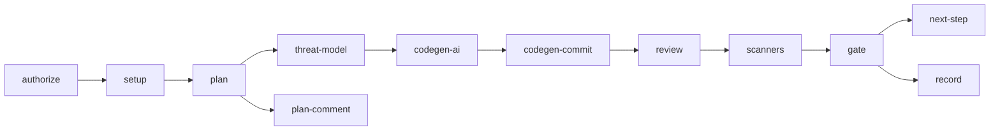
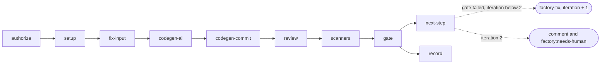
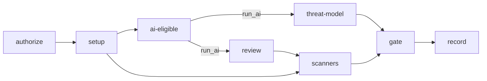

# Pipeline

A push to a project repo wakes its stub (`.github/workflows/factory.yml`, copied from `templates/project/`). The stub calls the reusable workflow `AakashDadhich/security-factory/.github/workflows/factory.yml@v1` (D17: the owner moves `v1` only after selftest and acceptance pass, see `docs/release.md`) with `secrets: inherit` and grants it `contents: read`. A reusable workflow can't hold more permissions than its caller grants, so later chunks widen the stub when they need more.

Every job checks out the factory at `inputs.factory-ref` into `.factory/` and runs `./.factory/.github/actions/setup-factory`. Results travel between jobs only as artifacts, one per stage, named after the stage.

The project is checked out at the workspace root, so it is untrusted code sitting in the current directory. The workflow sets `PYTHONSAFEPATH=1` for every job so `python -m` never imports a project's own `factory/`, `yaml.py` or `pip/` instead of the factory's. The `setup` job reads the Claude token before it checks out the project.

## Current job graph (walking skeleton)

| Job | Does | Artifact |
|---|---|---|
| `setup` | Checks out the project and the factory, validates the config with `python -m factory.config`, writes the run manifest with `python -m factory.manifest create`, checks whether `CLAUDE_CODE_OAUTH_TOKEN` is set | `setup` (`run-manifest.json`) |
| `passthrough` | Trivial stage: `python -m factory.passthrough` reads the manifest and writes an empty `findings.json` | `passthrough` |
| `hello-ai` | Only when the Claude token is present: installs claude-code and runs the hello prompt through `python -m factory.adapter`, then writes an empty `findings.json` | `hello-ai` (`hello.json`, `hello.json.meta.json`, `findings.json`) |
| `secrets` | Checks out the project with full history (`fetch-depth: 0`), installs the pinned Gitleaks and runs `python -m factory.stages.secrets`. See [Secrets stage](#secrets-stage) | `secrets` (`findings.json`, `gitleaks.sarif`) |
| `gate` | Always runs. Downloads every artifact into `in/<artifact>/` and runs `python -m factory.gate` | none |

## Secrets stage

`python -m factory.stages.secrets --repo . --out out/secrets` (or `make secrets`):

- runs `gitleaks git` over the whole history with `rules/gitleaks.toml` (Gitleaks defaults via `[extend] useDefault = true`), SARIF output to `out/secrets/gitleaks.sarif`, and `--redact=100` so the SARIF never holds a secret value,
- passes `--exit-code 99` because Gitleaks also exits 1 on its own errors. Exit 99 means leaks were found (findings, not a failure); any other non-zero exit fails the stage,
- turns every Gitleaks result into a `high` finding (D9: every committed secret counts, live or not), with CWE-798 and rotation advice,
- adds a `check` finding (`committed-env-file`, `high`, CWE-540) for each tracked file matching `(^|/)\.env(\.[^/]*)?$` except `.env.example` (D10),
- writes `out/secrets/findings.json`.

The same secret committed at the same path and line in several commits becomes one finding (the fingerprint ignores the commit).

## Spec and change modes

The project stub also triggers on `issues: [labeled]`. Label `factory:spec` runs mode `spec`, `factory:change` runs mode `change`; any other label skips the stub job. The stub passes the issue number as input `issue` and grants `issues: write`.

`authorize` is the first job in every run. In `spec` and `change` it runs `python3 -m factory.authorize --mode <m> --actor <sender> --allowed <list>` and fails unless both `github.event.sender.login` (who added the label) and `github.event.issue.user.login` (who wrote the issue) are in the repo variable `FACTORY_ALLOWED_ACTORS` (comma-separated, case-insensitive; an empty list refuses everyone). The author check matters because the issue body is fetched after the label is added, so an outside author could otherwise edit it in between. All values reach the script through `env:`. In other modes it passes without a check. `setup` needs `authorize`, and every other job needs `setup`, so a refused run calls no model. The gate is skipped after a refusal in spec or change mode; in any other mode it still runs with `if: always()` and fails closed.

### Plan stage

Job `plan` (spec and change modes, `contents: read`, `issues: read`) fetches the issue with `gh issue view --json title,body` into `out/plan/issue.json` and runs `python -m factory.stages.plan --issue-file out/plan/issue.json --config .factory.yml --out out/plan` (or `make plan ISSUE_FILE=...`). The stage calls the adapter with read-only tools, `prompts/plan.md` and a reply schema built from `schemas/plan.schema.json` without the derived fields, then sets them itself:

- `asvs_level`: the explicit `.factory.yml` value if set; otherwise 2, raised to 3 when `risk_rating` is `high` or `takes_payments` is true (D2),
- `personal_data`: `stores_personal_data`, or any `data_handled` entry classified `personal` or `sensitive`,
- `high_risk_features`: ids of features with risk `high`.

Feature and requirement ids must be unique and every feature needs at least one abuse case that names it; otherwise the stage exits 2. The artifact `plan` holds `plan.json`, an empty `findings.json`, `issue.json`, the raw `reply.json` and its `.meta.json`. Job `plan-comment` (`issues: write`, no AI) renders `plan.json` with `python -m factory.plan_comment` into a short Markdown comment and posts it with `gh issue comment`. Model text is escaped in the comment: Markdown punctuation is backslash-escaped, and `@` mentions and links are broken with a zero-width space. `plan` is a matrix stage for spec and change modes only.

### Threat model stage

Job `threat-model` (spec and change modes, needs `plan`, `contents: read`, no App key) checks out the project, installs claude-code and pytm, downloads artifact `plan` and runs `python -m factory.stages.threat_model --plan in/plan/plan.json --previous security --out out/threat-model` (or `make threat-model PLAN_FILE=...`). Up to four AI passes, all through the adapter with read-only tools (the first two always run):

1. **pytm model** (`prompts/threat-model-pytm.md`, reply `schemas/tm-source.schema.json`): input `plan.json` plus `security/tm.py` and `security/threats.json` when they exist. The reply's `tm_py` is checked with an AST allowlist (`factory/threatmodel/pytm_runner.py`): imports only `pytm` (not `sys`, so the model cannot change pytm's command line); from pytm only the model classes (never `Threat` or `Finding`, because pytm `eval()`s a threat's condition); no `open`, `exec`, `eval`, `compile`, `__import__`, `getattr`/`setattr`, `globals`/`vars`, `os`, `subprocess`; no `__` names except `__name__`; attributes only from an allowlist of pytm 1.4.0 element, data and control properties, enum members and `process` (a denylist missed paths like `gi_frame.f_globals`); no functions, classes, lambdas, loops, comprehensions, f-strings, `try`, `with` or non-integer subscripts; keyword arguments only from the same allowlist, with no `**` unpacking and never `threatsFile`, `condition`, `overrides`, `findings` or `sourceFiles`; no `report`, `load` or `loads`; and it must declare `TM`, `Boundary`, `Actor`, `Datastore`, `Dataflow`, a server or process, and call `tm.process()`. Only then is it written to `tm.py` and run through the fixed harness `factory/threatmodel/pytm_harness.py`, which loads the model without `__main__`, takes its one `TM` instance, resets `threatsFile` to pytm's bundled threat library and calls `process()` with the factory's own arguments. The harness runs in the pinned `pytm-sandbox` container (`python:3.12-slim` by digest) with `--network none`, `--read-only`, a small `noexec` tmpfs on `/tmp`, `--cap-drop ALL`, `no-new-privileges`, a 128 process and 1 GB memory cap, the job's uid, and no environment beyond `HOME=/work`. The output folder is the only writable mount (`/work`); the pytm venv's site-packages and the harness are mounted read-only, and the container's own process namespace keeps it away from the job's processes and their tokens. It runs with `-I` and a 120 s timeout (the container is removed on timeout), once with `--dfd` (saved as `dfd.dot`) and once with `--json` (`pytm.json`, normalised to `elements.json`: `boundaries`, `elements` with their class, `flows` with source and sink). Names must be unique and every flow must join known elements. On any validation or run error the stage asks the model once more (stage name `threat-model-pytm-retry`) with `tm.rejected.py` and `error.txt`; a second rejection exits 2.
2. **STRIDE** (`prompts/threat-model-stride.md`): input `elements.json`, `plan.json` and the previous `threats.json`. The reply schema is generated per run (`stride-reply.schema.json`): `element` must be a name from `elements.json`, `category` one of the six STRIDE categories, every threat needs at least one mitigation and every mitigation at least one ASVS id from `rules/asvs/asvs.json`. A `mitigated` threat needs `evidence`.

3. **LINDDUN** (`prompts/threat-model-linddun.md`), only when `plan.personal_data` is true. Same inputs and the same generated reply schema as STRIDE, with the seven categories `linking`, `identifying`, `non-repudiation`, `detecting`, `data-disclosure`, `unawareness`, `non-compliance`. Threats get `framework: linddun`.
4. **Attack trees** (`prompts/attack-tree.md`), once for each id in `plan.high_risk_features`. The stage writes `attack-trees/<feature_id>.feature.json` (the feature and its abuse cases) and a generated reply schema built from `schemas/attack-tree.schema.json`: the root `goal` must be one of that feature's abuse case `attacker_goal` values, leaf `element` a name from `elements.json`, ASVS ids from `rules/asvs/asvs.json`. A tree has at most 5 levels and 40 nodes (checked after validation; a breach fails the stage). `factory/threatmodel/attack_tree.py` flattens each leaf, in depth-first order, into a threat with `framework: attack-tree` and the feature id as `category`, and gives the leaf its `leaf_threat_id`. It writes `attack-trees/<feature_id>.json` (the numbered tree) and `attack-trees/<feature_id>.md`, a Mermaid flowchart (`and` as a hexagon, `or` as a rounded box, leaves with their threat id and severity, mitigations on dotted edges). Label text is escaped so it cannot close the diagram or the code fence.

The two conditional passes are deterministic: the triggers are plan fields, not model judgement. A pass that does not apply is skipped, and `passes.json` records every pass as `{"stride": {"status": "ran"}, "linddun": {"status": "ran"|"skipped", "reason": ...}, "attack-trees": {"status": "ran"|"skipped", "reason": ..., "features": [...]}}`. When a pass is skipped, threats of its framework from an earlier model move to `removed`. Stable ids work as for STRIDE, with attack tree leaves keyed by feature id, element and goal (or `previous_id` on the leaf). Adapter stage names: `threat-model-linddun`, `threat-model-attack-tree-<feature id lowercased, underscores as hyphens>`; fakes in `tests/fixtures/fake/`.

The factory then sets the rest: `framework` (`stride`, `linddun` or `attack-tree`); `severity` from likelihood times impact (9 critical, 6 high, 3 to 4 medium, else low); ids `TM-NNN` and mitigation ids `TM-NNN-Mn`. A threat keeps its previous id when its `previous_id` names a previous threat with the same category and element, or when category, element and normalised title match; otherwise it gets the next number, and numbers are never reused. Previous threats of a framework that are not matched move to `removed`. `model_version` is the SHA-256 of `tm.py`. Output in artifact `threat-model`: `tm.py`, `dfd.dot`, `pytm.json`, `elements.json`, `threats.json` (`schemas/threats.schema.json`), the replies with their `.meta.json`, and `findings.json` with one `info` finding per open threat (tool and stage `threat-model`, source `ai-threat-model`, rule id the threat id, location `security/threats.json`), so the report lists threats without blocking. `threat-model` is a matrix stage for spec and change modes only. This stage only produces artifacts; `codegen-ai` (see Code generation stages) commits `security/tm.py`, `security/threats.json` and the attack trees with the code.

## Improvement loop (change mode)

A change request is an issue labelled `factory:change` on a project that already has a record. It runs the same job graph as spec mode, so the matrix expects exactly the stages spec mode expects (`tests/test_change_mode.py` asserts it); there are no targeted re-runs. Job chain: `authorize`, `plan`, `threat-model`, `codegen-ai`, `codegen-commit`, `review`, every scanner, `gate`, `next-step`, `record`.

- **Plan.** In change mode the `plan` job first runs `python -m factory.record read --repo <repo> --out in/record` (a read of `factory-record`, with the job's read-only token in that one step), then `python -m factory.stages.plan --issue-file ... --current-plan security/plan.json --record in/record`. `security/plan.json` comes from the default branch checkout; the stage fails if it is missing, because a change needs a committed plan. The prompt is `prompts/plan-change.md`. Inputs: the issue, the current plan and `record.json` (written by the stage: `latest_findings`, the findings of the last passing default-branch run, clipped to 40; `failed_runs`, the last 3 `runs/` entries with status `fail`). The reply is a full updated plan plus `changed_features` and `touched_elements` (pytm element names, at least one). The reply schema leaves out the derived fields as in spec mode; the two new fields are optional in `schemas/plan.schema.json`, so spec plans stay valid.
- **Stable plan.** The stage exits 2 if the reply drops an existing feature or requirement id, or if `changed_features` names an unknown feature. `changed_features` in the written plan is the model's list plus every feature that is new or differs from the current plan, so an undeclared edit is still recorded. `asvs_level` is the spec rule (explicit config, else 2 or 3) but never lower than the current plan's level (D2).
- **Threat model.** `touched_elements` that exist in the rebuilt pytm model become `touched.json` and the STRIDE reply schema only allows those elements. STRIDE threats on other elements are carried over unchanged with their ids (a threat on an element that no longer exists moves to `removed`); touched ones are matched to old ids by `previous_id` or by category, element and title, and new ones take the next `TM-NNN`. If no touched element is in the model, the whole STRIDE pass runs. `passes.json` records `focus` and `ignored` for STRIDE. LINDDUN and attack trees follow the same triggers as spec mode (D3).
- **Pass comment.** On a pass, `next-step` fetches `security/threats.json` from the default branch and from `factory/<issue>`, runs `python -m factory.threatmodel.diff` and puts the result (threats added, changed with the changed fields, removed) before the gate report in the issue comment. The diff is computed from the branches, so it also works after fix-loop rounds. If the comparison cannot be made the comment is posted without it.
- **After merge.** The `record` job, on a passing push to the default branch, looks up the merged pull request of the commit; when its branch is `factory/<n>` it posts the record's `latest/sbom-diff.json` (dependencies added, removed, changed) on issue `n` (`python -m factory.sbomnote`). It needs `issues: write` (the stub already grants it) and is best effort.

## Code generation stages

Jobs `codegen-ai` and `codegen-commit` (spec and change modes; the matrix also lists fix mode for chunk 21) run after `threat-model`: `authorize → setup → plan → threat-model → codegen-ai → codegen-commit`. The security stages then check out the pushed commit (`needs.codegen-commit.outputs.sha`) and run on it, so a spec run scans the code it generated. In spec and change modes they wait for `codegen-commit` to succeed; in check mode they behave as before. `gate` also needs both jobs and checks out the same commit for the project config.

### codegen-ai

`contents: read`, the Claude token and no other credential; the job holds no write token. It installs claude-code, Semgrep with the community rules, Gitleaks and pre-commit (pinned in `tools/versions.lock`), downloads artifacts `plan` and `threat-model`, and runs `python -m factory.stages.codegen --plan in/plan/plan.json --threat-model in/threat-model --platform 
 --issue <n> --out out/codegen` (`make codegen`). The stage:

1. Checks out `factory/<issue>` (the remote branch if it exists, otherwise a new branch from the default branch) and records the commit as `base_sha`. The branch name is checked against `factory/<digits>`.
2. Writes the trusted files into the checkout: `CLAUDE.md` and `AGENTS.md` rendered with the platform, the plan's ASVS level and `threats.json` (`python -m factory.rules`), and `security/plan.json`, `security/tm.py`, `security/threats.json` and `security/attack-trees/<id>.md|json` copied from the artifacts.
3. Copies the tracked files and those trusted files into a temporary folder with **no `.git` folder** and runs the agent there through the adapter (`prompts/codegen.md`, reply `schemas/codegen-reply.schema.json`, tools Read, Grep, Glob, Edit, Write). The agent cannot run commands, so the generated code is never executed: nothing runs `npm`, the tests or the app in this job. The agent is told not to add dependencies because it cannot update a lock file. The copy has no git metadata so a write to `.git/config` or a hook cannot affect the git commands the job runs later, and symbolic links are refused.
4. Compares the copy with the baseline and applies only the differences to the real checkout, after a path check: not `.github/`, any `.env*` except `.env.example`, `.git`, scanner or hook configuration (`.semgrepignore`, `.gitleaksignore`, `.pre-commit-config.yaml`, `.npmrc` and similar), `CLAUDE.md`, `AGENTS.md`, `security/`, lock files; `package.json` dependencies and lifecycle scripts must not change; at most 300 files of at most 1 MiB. Files ignored by `.gitignore` are dropped. Changed files are staged by explicit path list, not the whole tree, because the job also holds `.factory/`, `in/` and `out/`.
5. Checks the staged patch (no symlinks or submodules, renames, binary content or `nosemgrep` and `gitleaks:allow` markers) and runs `pre-commit run` with the rendered `templates/precommit/.pre-commit-config.yaml`: only `repo: local` hooks calling the pinned `semgrep` (`--error --metrics=off --disable-nosem` and the platform's factory rule sets) and `gitleaks git --pre-commit --staged --redact=100` with `rules/gitleaks.toml`. The hooks get a minimal environment (no tokens).
6. A refusal (policy or hooks) goes back to the agent as `blocked-N.txt` and the agent runs again as adapter stage `codegen-fix-N`, at most 2 times. After that the stage exits 1 and `findings.json` holds one `high` finding with `source: check` and rule `precommit-blocked` or `patch-policy-blocked`.
7. Writes `changes.patch` (`git diff --binary --cached`) and `summary.json` (`branch`, `base_sha`, `files_changed`, `attempts`, `model`, `asvs_level`) and exposes `base_sha` as a job output. The artifact is `codegen-ai`.

### codegen-commit

No AI. It checks out `base_sha`, downloads `codegen-ai`, and in step `apply` (no token in the environment) re-checks the patch (same path rules, plus `--index` apply), re-runs pre-commit and commits as `aakashdadhich-factory-bot[bot]` with `feat: implement #<issue> (factory iteration <n>)` (`fix: address findings on #<issue> (factory iteration <n>)` in fix mode). Only then does it mint an App token (`actions/create-github-app-token`, `contents: write`, this repo only) and push `HEAD:refs/heads/factory/<issue>` in a separate step. The push target must match `factory/<digits>` and never the default branch, the head must equal the recorded commit, and the push is never forced, so a branch that moved since `base_sha` is rejected. `FACTORY_APP_PRIVATE_KEY` is used only here and in `record`. A refused patch writes a `high` finding (`patch-refused` or `precommit-blocked`) and exits 1. Output: artifact `codegen-commit` (`commit.json`, `findings.json`, the rendered pre-commit config); the job output `sha` is the pushed commit.

The two code generation stages are matrix stages for spec, change and fix modes. Fix mode is described under [Fix loop](#fix-loop).

## Fix loop

A failed gate does not end an issue's run. The `next-step` job (no AI, `contents: read`, `issues: write`) runs after `gate` in spec, change and fix modes and calls `python -m factory.fixloop decide`:

| Mode | Gate | Iteration | Action |
|---|---|---|---|
| spec, change, fix | fail | below 2 | `dispatch` |
| spec, change, fix | fail | 2 | `stop` |
| spec, change, fix | pass | any | `done` |
| check, or no gate result | any | any | `none` |

- `dispatch` mints an App token (`contents: write`, this repo only, the only place `next-step` holds the key) and sends `POST /repos/{repo}/dispatches` with `event_type: factory-fix` and `client_payload: {issue, iteration: <this + 1>, findings_run_id: <this run id>}`. Events made with the App token start runs, events made with `GITHUB_TOKEN` do not, which is why the App is used. The project stub maps `repository_dispatch` of type `factory-fix` to `mode: fix` and passes the payload as inputs `issue`, `iteration` and `findings-run-id`.
- `stop` comments the gate report on the issue under the heading "Factory stopped after 2 fix attempts" and adds the label `factory:needs-human` (created by the job if missing).
- `done` comments "Gate passed. Branch `factory/<issue>` is ready to merge." with the gate report. The owner merges (P4).
- Comment text comes from findings, which can contain text from the code under test, so `@` mentions and links are defanged and the comment is cut below GitHub's size limit.

`authorize` validates the fix inputs before anything else runs: `issue` and `findings-run-id` must be positive integers (at most 15 digits) and `iteration` must be 1 or 2. They reach scripts only through `env:`. A bad payload fails `authorize`, so `setup` and every model job are skipped and the gate does not run.

In fix mode `plan`, `plan-comment` and `threat-model` are skipped. Job `fix-input` (`contents: read`, `actions: read`, no AI) runs `gh run download <findings-run-id> --name gate --name setup`, checks that the earlier run failed, belongs to the same issue and had iteration one lower, and writes `blocking.json` with only the findings listed in `blocking_fingerprints` (most severe first, at most 40, text clipped). `codegen-ai` stays at `contents: read` with no GitHub token: it downloads artifact `fix-input` and runs `python -m factory.stages.codegen --fix-findings in/fix-input/blocking.json`, which requires `factory/<issue>` to exist on origin, reads `security/plan.json`, `threats.json`, `tm.py` and the attack trees from that branch, and runs the agent with `prompts/fix.md` and `schemas/fix-reply.schema.json` (adapter stages `fix` and `fix-retry-N`). The same patch policy, pre-commit hooks and `codegen-commit` apply as in spec mode, so the fix is committed to `factory/<issue>` by the bot, then `review` and every scanner run again on the new commit. `summary.json` gains `fixes` (one entry per finding: `fixed`, `partial` or `not-fixed`, with files and a note), `account` and `open_questions`. The agent cannot run commands, so a fix is only proven by the next gate run.

Concurrency: spec, change and fix runs share the group `factory-issue-<issue>` with `cancel-in-progress: false`, so runs for one issue queue instead of overlapping. Other runs get a group of their own. An issue gets at most three runs: the first, fix 1 and fix 2.

## Security review stage

Job `review` is the second-agent review: a fresh adversarial Claude pass over the diff, before the scanners. `contents: read`, the Claude token and no other credential (no App key, no write token). `authorize → setup → plan → threat-model → codegen-ai → codegen-commit → review`, and then `secrets`, `sast-*`, `deps-sbom` and `dast-web` all `need` it, so the review finishes before any scanner starts. A failed review does not stop the scanners (the report stays complete), but the gate fails closed on a failed or missing `review` artifact.

When it runs:
- Spec and change modes, after `codegen-commit` succeeded: head is the pushed commit (`needs.codegen-commit.outputs.sha`), base is `origin/<default branch>`.
- Check mode when `ai-eligible` says `run_ai` (see [Check mode](#check-mode)): on a pull request the base is `pull_request.base.sha`, on a default-branch push it is `before`, and the head is the PR head or the pushed commit. A push that creates the branch (`before` all zeros) is diffed against the empty tree. `review` is a matrix stage in check mode too.
- Fix mode is in the matrix for chunk 21 and is not wired into the workflow yet.

`python -m factory.stages.review --base <rev> --head <rev> --out out/review [--repo .] [--asvs-level 2] [--max-diff-bytes 200000]`:
1. Lists changed files with `git diff --name-only base...head` (never `security/`, which the factory generates) and takes each file's diff with `--unified=20`, parsing the hunks' new-side line ranges. Binary files have no hunks and are skipped.
2. Reads `security/threats.json` and `security/plan.json` at the head commit. Only `open` threats are passed on. The ASVS level is the plan's, else `--asvs-level` (the job passes the setup output), and `python -m factory.rules checklist` supplies the checklist.
3. Caps the diff at `--max-diff-bytes`. Files whose path or file name appears in an open threat come first, then files with more changed lines. A file that does not fit keeps the whole hunks that fit; what is left out is listed in `summary.json` and becomes one `info` check finding (`review-truncated`, source `check`, tool `factory`).
4. Runs the adapter (stage `review`, `prompts/security-review.md`, reply `schemas/review.schema.json`) with `Read,Grep,Glob` only. With no reviewable files the model is not called and the findings are empty.
5. Guards the reply deterministically. A finding whose `path` is not in the reviewed diff, or whose lines do not fit inside one reviewed hunk (changes plus their 20 lines of context), becomes `info` with a note. `confidence: low` caps the severity at `medium`. ASVS ids and threat ids that are not in the checklist or the open threats are dropped, with a note. Findings with the same path, start line and CWE collapse to the most severe.
6. Writes `findings.json` (stage `review`, source `ai-review`, tool = the adapter name with dashes, rule id `review-<first CWE>` or `review-general`), `summary.json`, `reply.json` and its meta, `diff.patch`, `checklist.json` and `threats.json`.

The gate report has a `### Review` section listing the unsuppressed findings from the `review` stage (`None.` when empty). High and critical review findings block like any scanner finding and can be suppressed by fingerprint with a reason and expiry. Exit codes follow the adapter (2 invalid reply, 75 usage limit).

## DAST web stage

Job `dast-web` (web only, required in the gate). `python -m factory.dast.harness up` creates the Docker network `factory-dast` with `--internal` (no route to the internet), builds the project's Dockerfile as `factory-app:<run id>`, and starts it detached with the alias `app`, `--read-only`, a tmpfs on `/tmp`, `--cap-drop ALL` and `no-new-privileges`. Only variables from `.env.example` are passed in. It then polls `http://app:<port><health_path>` from a pinned `curlimages/curl` container for up to 120 seconds and dumps the app logs on timeout.

`python -m factory.stages.dast_web --plan baseline` renders `zap/baseline.yaml` (target templated from `web.port`), runs the pinned ZAP image on the same network with `zap.sh -cmd -autorun`, and converts `zap-report.json` to findings (riskcode 3 high, 2 medium, 1 low, 0 info; CWE from `cweid`; fingerprint from plugin id, URL path and method). The artifact `dast-web` holds `findings.json`, `zap-report.json` and `zap-report.html`. `harness down` runs with `if: always()`.

### Authenticated scanning

An optional `web.auth` block in `.factory.yml` gives ZAP a seeded test login: `type` (`form` or `json`), `login_url` (a path on the app), `username_field`, `password_field`, `username_env`, `password_env` (names of variables in `.env.example`), and `logged_in_regex` and/or `logged_out_regex` (at least one). The schema rejects a block with any of the first six missing.

When it is set, `harness up` checks that `.env.example` defines both variables and starts the app with every `.env.example` variable plus `SEED_TEST_USER=1`; the app is expected to create that user at startup. The credentials are fake test values for the throwaway container only. The full plan then adds a ZAP context with the authentication method (`form` or `json`, request body built from the field names with ZAP's `` and `` placeholders), response verification from the regexes, cookie session management and one user, and the spider and active scan run as that user. The login URL is always `http://app:<port>` plus the path, so the target guard still applies, and authentication is only part of the full plan. The rendered plan file (which holds the test password) is deleted as soon as ZAP exits. Without `web.auth` the rendered plan is unchanged.

## Workflow inputs

| Input | Default | Meaning |
|---|---|---|
| `mode` | `check` | `spec`, `check`, `fix` or `change` |
| `factory-ref` | `main` (stubs pass `v1`) | Factory ref every job checks out into `.factory/` |
| `config-path` | `.factory.yml` | Project config file |
| `issue` | `0` | Issue number in spec, change and fix modes, `0` otherwise |
| `iteration` | `0` | Fix loop round, 1 or 2 in fix mode, `0` otherwise |
| `findings-run-id` | `0` | Fix mode: the run whose `gate` artifact lists the findings to fix |

Secret `CLAUDE_CODE_OAUTH_TOKEN` is optional. Without it, `hello-ai` is skipped and the gate still runs. Fork PRs never receive it.

## Project config

`python -m factory.config --path .factory.yml` validates the file against `schemas/factory-config.schema.json` and writes the GitHub outputs `platform`, `asvs_level` and `openapi`. A `null` or missing `asvs_level` becomes `2` (D2). `openapi` is empty when `web.openapi` isn't set. `platform: web` needs a `web` block; `macos` and `ios` need an `apple` block. Paths must be relative, inside the repo and on one line.

## Check mode

Check mode is every `push` and `pull_request` that is not a spec, change or fix run. The scanners and the gate always run. The two AI stages, the threat-model update and the review, run only when `ai-eligible` allows it (D18). The job needs only `setup`, has `contents: read`, calls no model and reads no secret value: it receives `secrets.CLAUDE_CODE_OAUTH_TOKEN != ''` (a boolean) through `env:` and runs `python -m factory.eligibility`. `run_ai` is true only when all of these hold:

| Condition | If not, `reason` |
|---|---|
| the event is `pull_request`, or a `push` (or `workflow_dispatch`) to the default branch | `work-in-progress-push` (also used for any other event) |
| the PR head repo is not a fork | `fork-pr` |
| the Claude token is available | `no-secret` |

The reasons are checked in the order fork, work in progress, secret. A Dependabot PR is not a fork and its `secrets` context holds the Dependabot repo secrets, which include `CLAUDE_CODE_OAUTH_TOKEN`, so it gets the full pipeline. Dependabot runs get a read-only `GITHUB_TOKEN` and no Actions secrets, so the jobs that need the App key (`record`) do not apply to them. Spec, change and fix runs ignore `ai-eligible` (their model jobs depend on the chain from `plan` or `fix-input`).

When `run_ai` is true:
- `threat-model` checks out the PR head (or pushed commit) with full history, writes `in/diff/diff.patch` (`git diff <base> HEAD`, `security/` excluded, cut at 200 KB) and runs `python -m factory.stages.threat_model --diff in/diff/diff.patch --previous security --out out/threat-model`. Inputs are `security/tm.py` and `security/threats.json` when the project has them, plus the diff; with neither, the model is bootstrapped from the code. There is no plan, so only the pytm model and the STRIDE pass run: the LINDDUN and attack tree passes are recorded as skipped in `passes.json`, and existing threats of those frameworks are kept unchanged. The AI-written model still goes through the AST allowlist and the no-network sandbox.
- `review` runs on the PR or push diff as described above.
- Neither job commits or writes anything. Results are the artifacts `threat-model` and `review`. When the gate passes on a default-branch push, `record` copies them to `latest/threats.json` and `latest/review.json` on `factory-record`.

When `run_ai` is false, both jobs are skipped and the scanners still run on the commit. A usage-limit failure (adapter exit 75) in either job is a failed stage, so the gate fails closed like any other stage failure; re-run the workflow after the limit resets.

Fork PRs and secrets: the stub triggers on plain `pull_request`, never `pull_request_target`. For a fork PR GitHub then sends no secrets and a read-only token, and the workflow runs the fork's code only inside jobs that hold nothing worth stealing. `pull_request_target` would run with the base repo's secrets and write token while the job checks out or builds code from the fork, which is the classic way for an outsider to steal a token. A test fails if either spelling appears in any workflow or template. Fork PRs therefore skip the AI stages (`fork-pr`), skip `record` and cannot upload SARIF to code scanning (that step is allowed to fail).

### Job graphs by mode

Dashed edges mean the job is skipped in that mode. Every job also needs `authorize` through `setup`; the scanners are `secrets`, `sast-semgrep`, `sast-codeql`, `sast-eslint`, `deps-sbom` and `dast-web` (web). `record` runs after `gate`, except for fork PRs.

Spec and change (issue labelled `factory:spec` or `factory:change`, allowlisted actor and author):

Fix (`repository_dispatch` `factory-fix`, iteration 1 or 2):

Check (every push and pull request):

In check mode the scanners wait for `review` only so the review finishes first; a skipped `review` does not hold them back.

## Gate

`python -m factory.gate --artifacts in --config .factory.yml --manifest in/setup/run-manifest.json --out out/gate --needs "$NEEDS"`, where `NEEDS` is `toJSON(needs)` (optional; without it the gate judges stages by their artifacts alone).

- The stages it expects come from `factory/stage_matrix.py` for the manifest's platform and mode. Any other job in `needs` (for example `passthrough`, `hello-ai`) is checked too: a failure blocks, a skip does not. A matrix stage can only be skipped if its entry lists a skip reason (`fork-pr`, `not-applicable`). The AI stages (`threat-model` and `review`, marked `ai=True`) are the exception: in check mode they may be skipped only when the `ai-eligible` job succeeded with `run_ai=false` and one of the three known reasons (`work-in-progress-push`, `fork-pr`, `no-secret`). The row then shows that reason, `gate-result.json` has `ai_skipped`, and `report.md` has the line `AI stages skipped: <reason>`. A skip with no such decision, or while `run_ai` is true, is `stage-missing`. In spec, change and fix modes the AI stages are never skippable. `ai-eligible` itself is a control job like `setup` and is not a stage row.
- A missing, failed or invalid expected stage becomes a `critical` finding (`source: check`, rule `stage-missing` or `stage-failed`, location `stages/<name>`). These cannot be suppressed. An unusable run manifest also fails the gate.
- Findings with the same path, overlapping lines and a shared CWE merge into one (highest severity wins; `tools`, `stages`, `cwe` and `merged_fingerprints` list everything). Findings without lines only merge with other lineless ones.
- Policy: `policy.yml` in the factory sets `fail_on`. A project's `.factory.yml` can add `policy.fail_on_extra: [medium]` (medium, low or info only). The schema has no way to remove a level.
- Suppressions: `.factory.yml` `suppressions:` entries with `fingerprint`, `reason`, `expires` (ISO date, today to 90 days ahead) and `approved_by`. A suppression matches any fingerprint that was merged into a finding. Expired or malformed entries are ignored and reported as `medium` findings (`suppression-expired-N`, `suppression-invalid-N`). Suppressed findings stay in the report, marked `suppressed`.
- Outputs in `out/gate/`: `report.json`, `report.md` (also appended to `$GITHUB_STEP_SUMMARY`), `gate-result.json` (`status`, `counts`, `suppressed`, `blocking_fingerprints`, `mode`, `iteration`, `stages`, `reasons`) and `merged.sarif`. The job uploads the folder as artifact `gate` and the SARIF to code scanning with category `factory-gate` (the upload is allowed to fail, as fork PRs have no `security-events` write access).
- Exits 1 when `status` is `fail`.

## macOS stages

For `platform: macos` the scanners are `secrets`, `sast-semgrep` (Swift rule sets), `deps-sbom`, plus three jobs on `macos-15` (`apple-build`, `sast-swiftlint`, `codeql-swift-analyze`), each with `contents: read` (`codeql-swift-analyze` also `security-events: write`). None sees the Claude token or the App key. The web-only stages (`sast-codeql`, `sast-eslint`, `dast-web`) are not in the macOS matrix and are skipped.

- `apple-build`: `python -m factory.tools install xcode xcodegen`, then `python -m factory.stages.apple_build run`. It runs `xcodegen generate --spec <apple.project_spec>`, copies a root `Package.resolved` into the generated project's workspace and passes `-onlyUsePackageVersionsFromResolvedFile`, then `xcodebuild -project <name>.xcodeproj -scheme <apple.scheme> -configuration Release -derivedDataPath build/apple CODE_SIGN_IDENTITY=- CODE_SIGN_STYLE=Manual CODE_SIGN_INJECT_BASE_ENTITLEMENTS=NO build`. Ad-hoc signing (`-`) still embeds the project's entitlements; `CODE_SIGN_INJECT_BASE_ENTITLEMENTS=NO` stops Xcode adding `get-task-allow` to the Release build, so `apple-checks` sees only what the project asked for. It expects exactly one `.app`, zips it with `ditto -c -k --keepParent` and uploads artifact `apple-build` (`<App>.app.zip` and an empty `findings.json`).
- `apple-checks`: runs inside the `apple-build` job after the build, on the same runner: `python -m factory.stages.apple_checks --app <path.app> --platform <macos|ios> --src . --out out/apple-checks`, uploaded as its own artifact `apple-checks` (there is no separate job, so the gate finds the stage by artifact name and a failed `apple-build` also leaves it missing). `factory/apple/inspect.py` has pure `plistlib` parsers (tested on Linux) and thin `codesign` wrappers (`codesign -d --entitlements :-`, `codesign -dv --verbose=4`). Rules, all source `check`, tool `factory-apple-checks`:
  - macOS only: `macos-hardened-runtime-missing` (high, no `runtime` flag), `macos-app-sandbox-disabled` (high, `com.apple.security.app-sandbox` missing or not true).
  - Both platforms: `get-task-allow-release` (high; the macOS key `com.apple.security.get-task-allow` or the iOS key `get-task-allow`); `entitlement-cs-disable-library-validation`, `entitlement-cs-allow-unsigned-executable-memory`, `entitlement-cs-allow-dyld-environment-variables` (high); `entitlement-temporary-exception-*` (medium, one per key).
  - ATS (Info.plist): `ats-allows-arbitrary-loads` (high); `ats-allows-arbitrary-loads-in-web-content`, `ats-exception-allows-insecure-http` (medium).
  - Privacy manifest (bundle first, then any `PrivacyInfo.xcprivacy` in the source): `privacy-manifest-missing`, `privacy-manifest-invalid` (high); `privacy-required-reason-<category>` (medium, first source hit, when the category is not in `NSPrivacyAccessedAPITypes`). Patterns live in `factory/apple/required_reason_apis.yml` with a link to Apple's documentation. Source scanning skips `.git`, `.factory`, `build`, `.build`, `Pods`, `Carthage`, `DerivedData`, `node_modules`, `out`, `*.xcodeproj` and comment lines.
  - Keychain: `keychain-accessible-always`, `keychain-accessible-always-this-device-only` (high, per occurrence in source). Secrets in UserDefaults stay with the Semgrep rules.
  - An unsigned or unreadable app, or an unreadable Info.plist, fails the stage (the gate then reports `stage-failed`).
- `sast-swiftlint`: `python -m factory.stages.swiftlint --src . --out out/sast-swiftlint`. Runs the pinned SwiftLint with `tools/swiftlint/.swiftlint.yml` only (copied to `out/sast-swiftlint/swiftlint.yml` with the `excluded` folders made absolute under the project, because SwiftLint resolves them against the config's own folder) (the project's own config is ignored) and the SARIF reporter. Exit 0 and 2 (error-level violations) are results; anything else fails the stage. Severity is by rule, not by SwiftLint's level: the `custom_rules` in the factory config (`print_of_secret`, `userdefaults_secret_key`) are `high`, every other rule is `low`.
- `codeql-swift-analyze` and `sast-codeql-swift`: CodeQL `languages: swift`, `build-mode: manual`, `security-extended`. Before `init`, `python -m factory.stages.apple_build script` generates the project and writes the xcodebuild command (same builders as `apple-build`, separate derived data folder `build/codeql`) to a shell script; the traced manual build step only runs that script. Python must stay out of the traced step: CodeQL's tracer starts processes as x86_64 and the runner's arm64 Python extensions fail to load. The analyze step writes `swift.sarif`, which the job uploads as artifact `codeql-swift-analyze` (with an empty `findings.json`, because the gate wants one from every job). The conversion runs in a separate Linux job, `sast-codeql-swift`, which downloads that artifact, runs `python -m factory.sarif` and uploads the stage artifact `sast-codeql-swift`. The macOS job is named `codeql-swift-analyze`; the CodeQL tracer leaves its x86_64 `libtrace.dylib` and environment in place for later steps, and the runner's arm64 Python extensions would not load there.

`deps-sbom` needs no macOS runner: OSV-Scanner and Syft both read a committed `Package.resolved`.

## iOS stages

For `platform: ios` the matrix is `secrets`, `sast-semgrep` (Swift rule sets), `sast-swiftlint`, `sast-codeql-swift`, `deps-sbom`, `apple-build`, `apple-checks` and `mobsf`, plus the AI stages. The four Apple jobs from "macOS stages" run for both Apple platforms (their `if` allows `macos` and `ios`); `mobsf` is iOS only.

- `apple-build` (iOS): `python -m factory.stages.apple_build run` reads `platform` from `.factory.yml` and builds `xcodebuild -project <name>.xcodeproj -scheme <apple.scheme> -configuration Release -sdk iphoneos -destination generic/platform=iOS -derivedDataPath build/apple CODE_SIGNING_ALLOWED=NO build`. The app lands in `build/apple/Build/Products/Release-iphoneos/<App>.app`. It is packaged by `package_ipa` (plain `zipfile`, fixed timestamps, keeps modes and symlinks) as `app.ipa` with `Payload/<App>.app/...`, and uploaded as artifact `apple-build` with an empty `findings.json`. No Apple account or signing identity is involved.
- `apple-checks` (iOS): the same step as macOS with `--platform ios --config .factory.yml`. An unsigned app has no code signature, so `codesign` is not run and the macOS-only rules do not apply; entitlements are read from the files the XcodeGen spec names (`CODE_SIGN_ENTITLEMENTS` in an application target's `settings.base`, or `entitlements.path`) so `get-task-allow-release` and the risky entitlement rules still work. A named file that is missing fails the stage.
- `sast-swiftlint`, `sast-codeql-swift`: unchanged. The CodeQL build script uses the same iOS command, so the traced build is `-sdk iphoneos`.
- `mobsf`: job on `ubuntu-24.04` (`contents: read`, no secrets) that needs `apple-build`, downloads its artifact, runs `python -m factory.tools install mobsf` (a digest-pinned `docker pull`) and `python -m factory.stages.mobsf --ipa in/apple-build/app.ipa --out out/mobsf`. The stage creates a per-run random API key (`fmobsf_` plus 32 random bytes, URL-safe), hands it to `docker run --env MOBSF_API_KEY` by name so it is never on a command line, binds the container to `127.0.0.1:8000`, waits for HTTP, then calls the REST API: `POST /api/v1/upload`, `POST /api/v1/scan`, `POST /api/v1/report_json`, each with the key in the `Authorization` header. The container is always removed. Anything MobSF could echo (container logs on failure, the saved report, error text) is passed through a redaction that replaces the key with `***`; MobSF itself prints its API key at start-up. The artifact `mobsf` holds `findings.json` and the raw `mobsf-report.json`.
- MobSF findings come from the report's `appsec` section: `high` becomes high, `warning` medium, `info` info; `secure` and `hotspot` are dropped. Stage and tool `mobsf`, source `scanner`, rule id `mobsf-<slug of the title>`, location the `.ipa` file name, and an entry repeated at several severities keeps the highest. MobSF dynamic analysis for iOS needs Corellium (paid) and is not used (D12).

