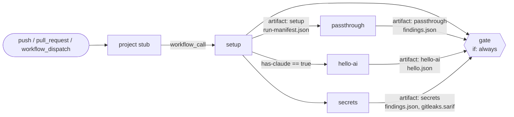

# Pipeline

A push to a project repo wakes its stub (`.github/workflows/factory.yml`, copied from `templates/project/`). The stub calls the reusable workflow `AakashDadhich/security-factory/.github/workflows/factory.yml@main` (D17: `@v1` once chunk 30 creates it) with `secrets: inherit` and grants it `contents: read`. A reusable workflow can't hold more permissions than its caller grants, so later chunks widen the stub when they need more.

Every job checks out the factory at `inputs.factory-ref` into `.factory/` and runs `./.factory/.github/actions/setup-factory`. Results travel between jobs only as artifacts, one per stage, named after the stage.

The project is checked out at the workspace root, so it is untrusted code sitting in the current directory. The workflow sets `PYTHONSAFEPATH=1` for every job so `python -m` never imports a project's own `factory/`, `yaml.py` or `pip/` instead of the factory's. The `setup` job reads the Claude token before it checks out the project.

## Current job graph (walking skeleton)

| Job | Does | Artifact |
|---|---|---|
| `setup` | Checks out the project and the factory, validates the config with `python -m factory.config`, writes the run manifest with `python -m factory.manifest create`, checks whether `CLAUDE_CODE_OAUTH_TOKEN` is set | `setup` (`run-manifest.json`) |
| `passthrough` | Trivial stage: `python -m factory.passthrough` reads the manifest and writes an empty `findings.json` | `passthrough` |
| `hello-ai` | Only when the Claude token is present: installs claude-code and runs the hello prompt through `python -m factory.adapter`, then writes an empty `findings.json` | `hello-ai` (`hello.json`, `hello.json.meta.json`, `findings.json`) |
| `secrets` | Checks out the project with full history (`fetch-depth: 0`), installs the pinned Gitleaks and runs `python -m factory.stages.secrets`. See [Secrets stage](#secrets-stage) | `secrets` (`findings.json`, `gitleaks.sarif`) |
| `gate` | Always runs. Downloads every artifact into `in/<artifact>/` and runs `python -m factory.gate` | none |

## Secrets stage

`python -m factory.stages.secrets --repo . --out out/secrets` (or `make secrets`):

- runs `gitleaks git` over the whole history with `rules/gitleaks.toml` (Gitleaks defaults via `[extend] useDefault = true`), SARIF output to `out/secrets/gitleaks.sarif`, and `--redact=100` so the SARIF never holds a secret value,
- passes `--exit-code 99` because Gitleaks also exits 1 on its own errors. Exit 99 means leaks were found (findings, not a failure); any other non-zero exit fails the stage,
- turns every Gitleaks result into a `high` finding (D9: every committed secret counts, live or not), with CWE-798 and rotation advice,
- adds a `check` finding (`committed-env-file`, `high`, CWE-540) for each tracked file matching `(^|/)\.env(\.[^/]*)?$` except `.env.example` (D10),
- writes `out/secrets/findings.json`.

The same secret committed at the same path and line in several commits becomes one finding (the fingerprint ignores the commit).

## Workflow inputs

| Input | Default | Meaning |
|---|---|---|
| `mode` | `check` | `spec`, `check`, `fix` or `change` (only `check` exists so far) |
| `factory-ref` | `main` | Factory ref every job checks out into `.factory/` |
| `config-path` | `.factory.yml` | Project config file |

Secret `CLAUDE_CODE_OAUTH_TOKEN` is optional. Without it, `hello-ai` is skipped and the gate still runs. Fork PRs never receive it.

## Project config

`python -m factory.config --path .factory.yml` validates the file against `schemas/factory-config.schema.json` and writes the GitHub outputs `platform`, `asvs_level` and `openapi`. A `null` or missing `asvs_level` becomes `2` (D2). `openapi` is empty when `web.openapi` isn't set. `platform: web` needs a `web` block; `macos` and `ios` need an `apple` block. Paths must be relative, inside the repo and on one line.

## Gate

`python -m factory.gate --artifacts in --config .factory.yml --manifest in/setup/run-manifest.json --out out/gate --needs "$NEEDS"`, where `NEEDS` is `toJSON(needs)` (optional; without it the gate judges stages by their artifacts alone).

- The stages it expects come from `factory/stage_matrix.py` for the manifest's platform and mode. Any other job in `needs` (for example `passthrough`, `hello-ai`) is checked too: a failure blocks, a skip does not. A matrix stage can only be skipped if its entry lists a skip reason (`fork-pr`, `not-applicable`).
- A missing, failed or invalid expected stage becomes a `critical` finding (`source: check`, rule `stage-missing` or `stage-failed`, location `stages/<name>`). These cannot be suppressed. An unusable run manifest also fails the gate.
- Findings with the same path, overlapping lines and a shared CWE merge into one (highest severity wins; `tools`, `stages`, `cwe` and `merged_fingerprints` list everything). Findings without lines only merge with other lineless ones.
- Policy: `policy.yml` in the factory sets `fail_on`. A project's `.factory.yml` can add `policy.fail_on_extra: [medium]` (medium, low or info only). The schema has no way to remove a level.
- Suppressions: `.factory.yml` `suppressions:` entries with `fingerprint`, `reason`, `expires` (ISO date, today to 90 days ahead) and `approved_by`. A suppression matches any fingerprint that was merged into a finding. Expired or malformed entries are ignored and reported as `medium` findings (`suppression-expired-N`, `suppression-invalid-N`). Suppressed findings stay in the report, marked `suppressed`.
- Outputs in `out/gate/`: `report.json`, `report.md` (also appended to `$GITHUB_STEP_SUMMARY`), `gate-result.json` (`status`, `counts`, `suppressed`, `blocking_fingerprints`, `mode`, `iteration`, `stages`, `reasons`) and `merged.sarif`. The job uploads the folder as artifact `gate` and the SARIF to code scanning with category `factory-gate` (the upload is allowed to fail, as fork PRs have no `security-events` write access).
- Exits 1 when `status` is `fail`.
