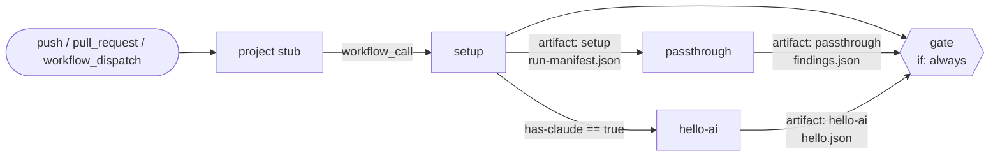

# Pipeline

A push to a project repo wakes its stub (`.github/workflows/factory.yml`, copied from `templates/project/`). The stub calls the reusable workflow `AakashDadhich/security-factory/.github/workflows/factory.yml@main` (D17: `@v1` once chunk 30 creates it) with `secrets: inherit` and grants it `contents: read`. A reusable workflow can't hold more permissions than its caller grants, so later chunks widen the stub when they need more.

Every job checks out the factory at `inputs.factory-ref` into `.factory/` and runs `./.factory/.github/actions/setup-factory`. Results travel between jobs only as artifacts, one per stage, named after the stage.

## Current job graph (walking skeleton)

| Job | Does | Artifact |
|---|---|---|
| `setup` | Checks out the project and the factory, validates the config with `python -m factory.config`, writes the run manifest with `python -m factory.manifest create`, checks whether `CLAUDE_CODE_OAUTH_TOKEN` is set | `setup` (`run-manifest.json`) |
| `passthrough` | Trivial stage: `python -m factory.passthrough` reads the manifest and writes an empty `findings.json` | `passthrough` |
| `hello-ai` | Only when the Claude token is present: installs claude-code and runs the hello prompt through `python -m factory.adapter` | `hello-ai` (`hello.json`, `hello.json.meta.json`) |
| `gate` | Always runs. Downloads every artifact into `in/<artifact>/` and runs `python -m factory.gate` | none |

## Workflow inputs

| Input | Default | Meaning |
|---|---|---|
| `mode` | `check` | `spec`, `check`, `fix` or `change` (only `check` exists so far) |
| `factory-ref` | `main` | Factory ref every job checks out into `.factory/` |
| `config-path` | `.factory.yml` | Project config file |

Secret `CLAUDE_CODE_OAUTH_TOKEN` is optional. Without it, `hello-ai` is skipped and the gate still runs. Fork PRs never receive it.

## Project config

`python -m factory.config --path .factory.yml` validates the file against `schemas/factory-config.schema.json` and writes the GitHub outputs `platform`, `asvs_level` and `openapi`. A `null` or missing `asvs_level` becomes `2` (D2). `openapi` is empty when `web.openapi` isn't set. `platform: web` needs a `web` block; `macos` and `ios` need an `apple` block. Paths must be relative, inside the repo and on one line.

## Gate (stub)

`python -m factory.gate --artifacts in --needs "$NEEDS"`, where `NEEDS` is `toJSON(needs)`:

- validates every `in/*/findings.json` against the findings schema,
- counts findings by severity and writes a Markdown table to `$GITHUB_STEP_SUMMARY` (and stdout),
- exits 1 if any finding is `critical` or `high`, any findings file is invalid, or any needed job ended `failure` or `cancelled`. A `skipped` job (for example `hello-ai` with no token) doesn't fail the gate.

Chunk 11 replaces this stub with the real gate and report.
