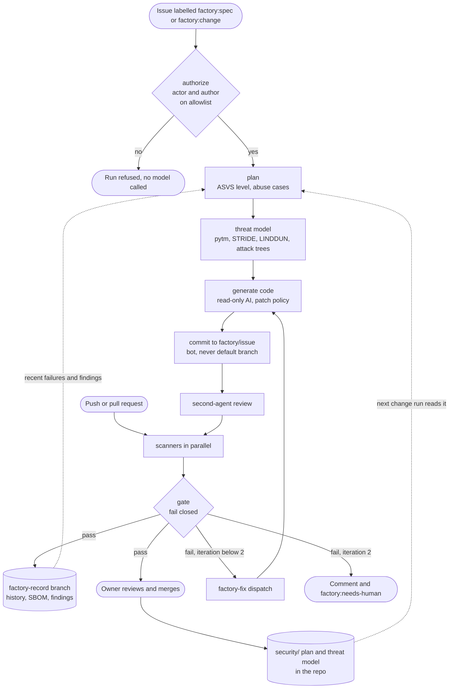
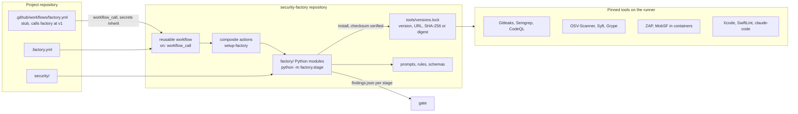
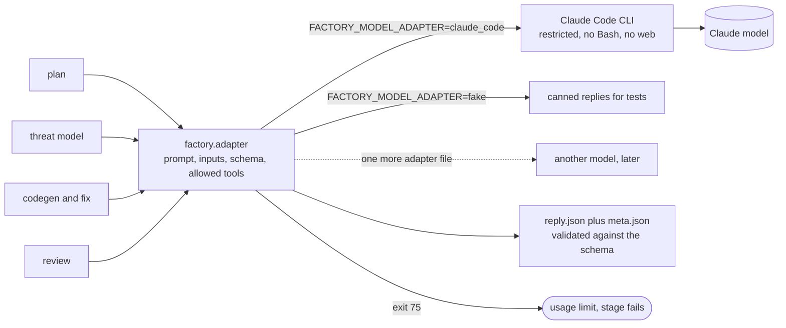
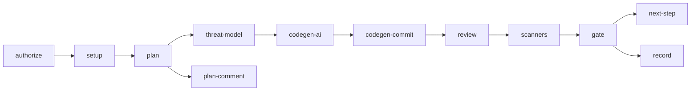
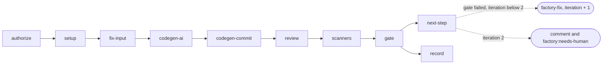
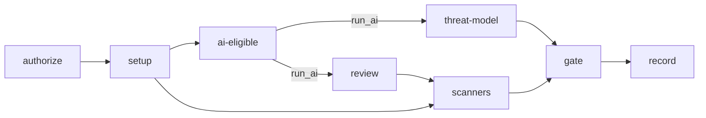

# Diagrams

Four views of the factory. Sources: [pipeline.md](../pipeline.md), [adapter.md](../adapter.md), [.github/workflows/factory.yml](../../.github/workflows/factory.yml).

## End-to-end flow

An issue or a push starts a run. The gate decides. A failed gate in spec, change or fix mode starts the fix loop (at most two rounds). A merged change feeds the improvement loop: the next change run reads the committed plan and threat model and only re-analyses what it touches.

## CI layout

The project holds only a stub. Everything else lives in the factory repository and is checked out into `.factory/` at the pinned ref.

## Model adapter

Stages never call a model directly. They hand the adapter a prompt, inputs and a schema, and get validated JSON back.

## Job graphs by mode

Every job also needs `authorize` through `setup`. The scanners are `secrets`, `sast-semgrep`, `sast-codeql`, `sast-eslint`, `deps-sbom` and `dast-web` for web, and `apple-build` with `apple-checks`, `sast-swiftlint`, `sast-codeql-swift`, `deps-sbom` and `mobsf` for Apple.

Spec and change:

Fix:

Check:

